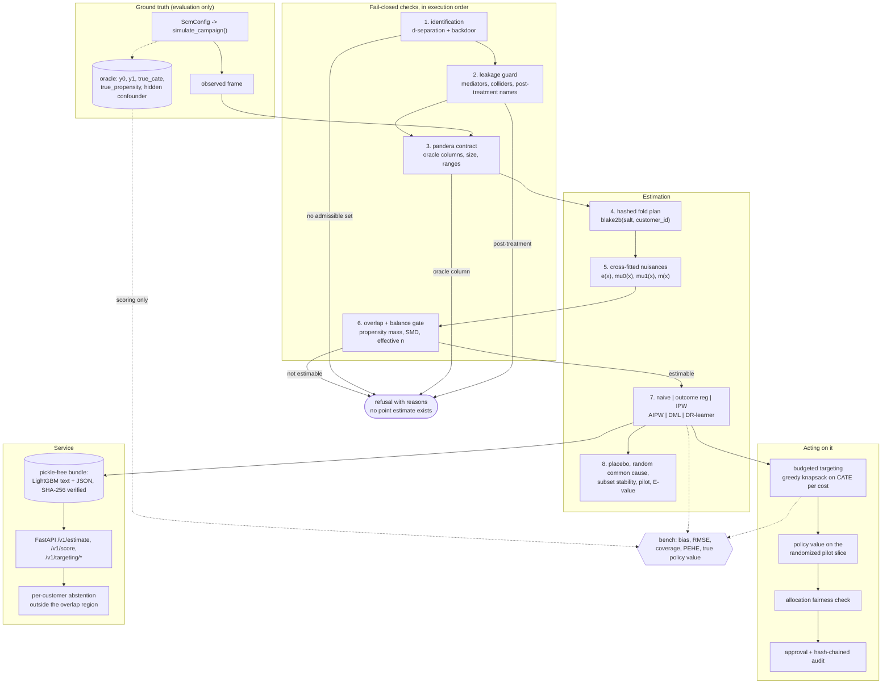

# Double-ML Uplift Engine

Works out which customers a retention offer actually *changes* — rather than which customers merely
look likely to leave — and refuses to report a number at all when the data cannot support one.

## Problem

A subscription business is about to send a discount to a fifth of its customers. The usual way to
pick them is a churn model: score everyone on how likely they are to cancel, then make the offer to
the top slice. That ranking spends the budget on two groups it should not touch.

- Customers who were going to stay anyway. The discount is a pure giveaway.
- Customers the offer annoys. Reminding somebody that their contract is expensive can push them out
  the door.

The question a retention campaign actually has is causal — *whose behaviour does the offer change?* —
and a churn model answers a different one: *who looks likely to leave?*

Reaching for last year's campaign data does not fix it, because last year's campaign was targeted by
a rule. The customers who got an offer already differ from the ones who did not, so the plain
difference between the two groups measures the old targeting rule, not the offer. In the Monte Carlo
below, that plain difference is off by **−19.1** units of retained revenue per customer when the
true average effect is **+3.4**. The error is larger than the effect and points the other way, so an
offer that helps is reported as an offer that hurts.

The money at stake is measurable here too. At a 20% budget, ranking customers the old way — by how
likely they were to be targeted — has a true value of **−6.4** units of retained revenue per
customer: the campaign destroys value. Ranking the same customers by estimated uplift, on the same
budget, has a true value of **+10.3**. Same spend, opposite outcome.

Removing that bias requires assumptions, and no software can prove them. This repository's position
is that the assumptions should be written down, checked wherever they are checkable, and allowed to
fail loudly rather than quietly. Nothing here discovers what causes what. It checks that the
cause-and-effect diagram *you declared* is internally consistent, that it identifies the effect from
the columns you actually have, and that the data can support the estimate. That distinction is the
whole product; [MODEL_CARD.md](MODEL_CARD.md) records what it buys and what it costs.

## What this does

- **Estimates the effect of the offer for each individual customer**, including where that effect is
  negative. The industry word for this is *uplift*: the change the offer causes.
- **Refuses to answer when the data cannot support an answer.** If no combination of recorded
  columns removes the bias, or if the offered and un-offered customers are too dissimilar to
  compare, the result is a refusal listing reasons — not a number with a warning attached. There is
  never a point estimate lying around for somebody to quote after the refusal.
- **Keeps the assumptions in a file you can review.** The cause-and-effect diagram is
  version-controlled YAML, and its fingerprint is recorded with every estimate. Change the
  assumptions and the fingerprint changes with them.
- **Scores itself against a simulator that knows the true answer.** Every estimator is run against
  simulated campaigns where the real per-customer effect is known, so the accuracy claims below are
  measured rather than asserted.
- **Makes acting on the answer deliberate.** Exporting a list of customers to contact needs a second
  person's approval, releases pseudonyms instead of identities, is checked for lopsided treatment of
  protected groups, and is recorded in a log that cannot be edited without detection.

## Architecture



### How one estimate flows through it

The numbers match the diagram. Everything that could refuse runs before a point estimate exists.

1. **Identification.** Before any data is loaded, the engine reads the declared diagram and searches
   for a set of observed columns that closes every path where a shared cause could masquerade as an
   effect. If no such set exists, it refuses and names the path it could not close. This happens at
   construction time, so an unidentifiable question never reaches the data.
2. **Leakage guard.** The proposed set is re-checked independently for anything measured *after* the
   offer went out — logins afterwards, whether the offer was redeemed, a later satisfaction survey.
   Adjusting for those would absorb the very effect being measured, so they are a hard failure, even
   if the declared roles in the file say otherwise.
3. **Data contract.** The uploaded table is validated: column types, ranges, row and column limits,
   and a check that it carries none of the simulator's answer key. A frame containing `y0`, `y1`,
   `true_cate`, `true_propensity` or `hidden_confounder` is refused by name, with its own exception
   type, before any other check runs.
4. **Fold plan.** Each customer is assigned to one of five folds by `blake2b(salt, customer_id)`.
   Because the fold depends only on the id and a configured salt, reordering or subsetting the rows
   does not move anybody, so two runs an analyst would call "the same run" produce the same number.
5. **Cross-fitted nuisance models.** Four helper models are fitted — the chance of having been
   offered, the expected revenue under each arm, and the average revenue — each one predicting only
   the folds it never saw. This is the "double machine learning" part: predictions never come from a
   model that trained on the row it is predicting, which is what removes the bias that flexible
   models otherwise introduce.
6. **Overlap and balance gate.** Now the diagnostics can run, because they need the fitted
   propensities. If too much probability mass sits at the extremes — customers who were essentially
   certain to be offered, or certain not to be — there is no comparable group to compare them with,
   and the gate refuses. This is the only step that needs a model in order to decide whether a
   number is allowed to exist.
7. **Estimators.** Six estimators run on the same cross-fitted quantities: the naive difference
   (kept as a baseline that visibly fails), outcome regression, clipped inverse-probability
   weighting, AIPW, partialling-out DML with influence-function standard errors and a bootstrap
   interval, and a DR-learner for the per-customer effect.
8. **Refuters.** Four checks try to contradict the estimate — a fake treatment, an injected
   irrelevant cause, stability across random subsets, and agreement with the randomized pilot slice
   — plus an advisory E-value saying how strong an unmeasured confounder would have to be to explain
   the result away. A refuter that could not run reports `skipped` and withholds its pass rather
   than granting one.

Then the estimate can be acted on: rank customers by predicted uplift per unit cost, fill the budget
greedily, value the resulting policy on the randomized slice rather than on the data the model was
trained on, check the allocation across protected groups, and require a second operator's approval
before any list leaves the building.

Layout:

```text
src/double_ml_uplift/
  causal/   scm, spec, graph, identification, folds, nuisance, estimators,
            diagnostics, refutation, calibration, targeting, engine, bundle,
            publish (run manifest + registry), demo
  service/  app, auth (JWT roles), approvals, audit, identifiers, metrics, models
  ml/       pandera contracts, run manifest, registry, PSI/KS drift, safe serialization
  core/     settings, redacting logs, tracing, metrics, hardened FastAPI app
  configs/  scenarios/*.yaml (SCM draws)   specs/*.yaml (declared DAGs)
bench/bench_montecarlo.py   bench/bench_baseline.py   scripts/check_baseline.py
docs/CAUSAL_SPEC.md   docs/THREAT_MODEL.md   docs/adr/   CLAIMS.md   MODEL_CARD.md
```

## Results

Measured on this machine, not estimated: Windows 10, 6 CPU cores, Python 3.12.14, CPU only, no GPU.
Every number below is reproduced by the command shown above its table and stored in
`bench/results/`. `CLAIMS.md` maps each claim to the test or bench script that holds it.

Four numbers, if you only read four:

| Measured | What it means | Command |
|---|---|---|
| Naive difference is biased by **−19.1**; true effect **+3.4** | The obvious calculation on historical campaign data is wrong by more than the size of the effect, and in the wrong direction | `uv run python bench/bench_montecarlo.py --replications 50 --check` |
| DML interval covers the truth **94–96%** of the time | When this tool reports "the effect is between X and Y with 95% confidence", the truth really is in that range roughly 95 times in 100 | same |
| Targeting by uplift is worth **+10.3** per customer vs **−6.4** for propensity ranking | At the same 20% budget, this ranking makes money where the conventional ranking loses it | same |
| Overlap gate refuses **100%** of the unsupportable scenario and **0%** of the sound ones | The refusal is not a blanket no. It fires on the cases that deserve it and stays quiet otherwise | same |

### Estimator accuracy against ground truth

```bash
uv run python bench/bench_montecarlo.py --replications 50 --check
```

50 replications per scenario, n = 2,000, 217.6 s total. The gate is measured but not enforced here,
on purpose: the point is to show what it protects against.

*Bias* is how far the average estimate sits from the truth. *RMSE* is typical total error.
*Coverage* is the fraction of runs whose 95% confidence interval contained the true answer — it
should be about 0.95, and a number far below that means the tool is claiming more certainty than it
has earned.

| scenario | estimator | bias | RMSE | empirical SD | mean SE | coverage |
|---|---|---:|---:|---:|---:|---:|
| linear | naive | -13.675 | 15.079 | 6.418 | 6.873 | 0.520 |
| linear | outcome_regression | -3.247 | 4.172 | 2.645 | 1.103 | 0.320 |
| linear | ipw | +0.160 | 4.196 | 4.236 | 8.783 | 1.000 |
| linear | aipw | +1.910 | 3.535 | 3.005 | 3.942 | 0.980 |
| linear | dml | -0.386 | 2.562 | 2.559 | 2.569 | 0.960 |
| nonlinear | naive | -10.442 | 12.797 | 7.473 | 8.376 | 0.800 |
| nonlinear | outcome_regression | -7.320 | 7.778 | 2.655 | 1.216 | 0.020 |
| nonlinear | ipw | -0.497 | 6.213 | 6.256 | 11.151 | 1.000 |
| nonlinear | aipw | +2.061 | 4.614 | 4.170 | 4.997 | 0.980 |
| nonlinear | dml | -1.423 | 2.797 | 2.432 | 2.812 | 0.940 |
| heterogeneous | naive | -19.060 | 20.184 | 6.711 | 7.231 | 0.200 |
| heterogeneous | outcome_regression | -3.275 | 4.213 | 2.678 | 1.395 | 0.460 |
| heterogeneous | ipw | +0.574 | 4.416 | 4.423 | 9.200 | 1.000 |
| heterogeneous | aipw | +1.852 | 3.677 | 3.209 | 4.076 | 0.960 |
| heterogeneous | dml | -0.194 | 2.750 | 2.771 | 2.797 | 0.960 |
| weak_overlap | naive | -24.769 | 25.440 | 5.866 | 6.948 | 0.020 |
| weak_overlap | outcome_regression | -11.717 | 12.172 | 3.328 | 1.302 | 0.000 |
| weak_overlap | ipw | +5.455 | 11.959 | 10.751 | 17.163 | 1.000 |
| weak_overlap | aipw | +6.476 | 9.694 | 7.287 | 11.129 | 1.000 |
| weak_overlap | dml | -1.592 | 3.773 | 3.455 | 3.305 | 0.940 |

Reading it: AIPW and DML land in the 0.91–0.98 coverage band CI enforces, including when the helper
models are misspecified (`nonlinear`). The naive difference is badly biased and its intervals cover
the truth 20–52% of the time.

Outcome regression is the interesting failure, and the reason this repository exists. It is *nearly
unbiased* — off by only 3.2 in the `linear` scenario — and still covers the truth 2–46% of the time,
because its reported standard error (1.1–1.4) ignores the error in estimating the helper models and
is two to two-and-a-half times too small against the spread the estimates actually show. A plug-in
"predict both arms and subtract" pipeline looks excellent
right up to the moment somebody believes its interval. That failure is invisible without ground
truth to score against, which is why the ground truth is in the repository.

IPW's 1.000 coverage is the opposite failure: its mean standard error is roughly twice its actual
spread, so the interval is wide enough to be nearly useless.

`weak_overlap` is the row the gate exists for. DML's residual-on-residual form happens to survive
it, but AIPW's bias more than triples and IPW's RMSE goes to 12. In production none of these numbers
is reported at all:

| scenario | gate refusal rate |
|---|---:|
| linear | 0.000 |
| nonlinear | 0.000 |
| heterogeneous | 0.000 |
| weak_overlap | 1.000 |

A refusal rate of 1.000 on `weak_overlap` and 0.000 everywhere else is the property that matters: a
gate that refuses everything would be safe and useless.

### Per-customer effects, refuters, and targeting

Same command. *PEHE* is the typical error in the per-customer effect — lower is better. The
comparison that matters is against predicting one average number for everybody, which is what a
campaign does when it has no per-customer model at all.

| scenario | PEHE DR-learner | PEHE outcome regression | PEHE constant ATE | calibration slope |
|---|---:|---:|---:|---:|
| heterogeneous | 11.62 | 31.00 | 43.73 | 1.088 |
| nonlinear | 11.75 | 36.76 | 22.84 | 0.890 |

The DR-learner's per-customer error is about a quarter of what you get by assuming everybody
responds the same way (11.62 vs 43.73 in `heterogeneous`). A calibration slope near 1 means that
when it predicts twice the effect, the effect really is about twice as large.

| refuter | false-flag rate on a well-specified scenario |
|---|---:|
| placebo_treatment | 0.000 |
| random_common_cause | 0.000 |
| subset_stability | 0.000 |
| pilot_consistency | 0.000 |
| e_value (advisory) | 0.100 |

A false-flag rate of 0.000 means these checks did not cry wolf on any of the 10 sound draws. A check
that fired constantly would be ignored within a week.

Unmeasured-confounder detection rate: **0.920** (mean bias **+64.0** when it is present, over 25
draws). When a strong hidden cause is present and the estimate is off by 64 units, the
randomized-pilot check catches it in 23 of 25 draws. It is the only refuter here that can see hidden
confounding at all, because it is the only one that does not assume the absence of it.

| targeting at a 20% budget | value |
|---|---:|
| pilot CI covers the true policy value | 1.000 |
| uplift ranking beats propensity ranking | 1.000 |
| mean true value, uplift ranking | 10.329 |
| mean true value, propensity ranking | -6.405 |
| mean true value, treat everyone | 3.436 |

Propensity ranking — offer to whoever the old rule would have picked — has *negative* true value: it
systematically finds the customers the offer harms. Treating everybody is positive but small.
Uplift ranking, at a fifth of the budget, is worth three times treating everybody. And the value
estimated from the randomized slice contained the true value in all 10 draws, which means the
forecast you would have shown a stakeholder before rollout was honest.

### The exact differential

`tests/unit/test_estimators.py::test_dml_without_crossfitting_equals_the_ols_coefficient` asserts
that partialling-out DML with OLS helper models and cross-fitting disabled equals the statsmodels
OLS coefficient on the treatment to 1e-8 (Frisch–Waugh–Lovell). Two independent implementations of
the same quantity agreeing to eight decimal places is the cheapest evidence that the residualisation
is right, and if anybody rewrites it, that test says so immediately.

### Throughput

```bash
uv run python bench/bench_baseline.py --check --rows 200000
```

p50 is the median; p95 is the slowest 1 in 20.

| benchmark | runs | p50 (us) | p95 (us) | in plain terms |
|---|---:|---:|---:|---|
| d_separation_24_node_dag | 2000 | 49.2 | 61.1 | 0.05 ms to decide independence on a 24-node graph |
| identify_backdoor_retention_spec | 200 | 253.8 | 361.8 | 0.25 ms to search the graph for a valid adjustment set |
| fold_assignment_100k_ids | 10 | 114888.8 | 126860.5 | 0.11 s to assign 100,000 customers to folds |
| cross_fit_10k_rows_5_folds_gbm | 5 | 872059.4 | 1023900.5 | 0.87 s to fit four helper models five times over 10,000 rows |
| score_10k_rows | 20 | 12057.5 | 14136.7 | 12 ms to score 10,000 customers, about 1.2 us each |
| drift_check_10k_vs_10k | 30 | 2156.8 | 2248.0 | 2.2 ms to compare two 10,000-row distributions |
| audit_append_fsync | 100 | 6986.0 | 8125.3 | 7.0 ms to write one audit line and flush it to disk |
| audit_verify_500_entries | 10 | 9904.4 | 13335.3 | 9.9 ms to re-verify a 500-entry hash chain |

One full five-fold DML pass end to end, at 200,000 rows and six adjustment columns:

| scaling (200,000 rows, 5-fold DML) | prepare (s) | fit (s) | ATE | SE |
|---|---:|---:|---:|---:|
| ridge nuisances | 0.237 | 1.712 | 22.5772 | 0.2300 |
| gbm nuisances | 0.260 | 17.046 | 22.2267 | 0.2382 |

True ATE for that sample: **22.3984**. Both configurations recover it — ridge lands 0.18 high, gbm
0.17 low, each well inside its own standard error. The LightGBM helper models cost about ten times
the wall clock of ridge on this (linear) scenario and earn it back on the `nonlinear` one.
`bench/thresholds.json` sets each p95 limit at roughly five times the measured value, so CI catches
an order-of-magnitude regression without failing on runner noise. The scaling section is reported,
not thresholded: the machine matters far more than the code.

## How it works

Five components, in the order a request meets them.

| Component | Responsibility | Where |
|---|---|---|
| Specification | The declared cause-and-effect diagram, parsed as data, validated for structure, hashed | `causal/spec.py` |
| Identification | d-separation and Pearl's backdoor criterion over that diagram; returns an adjustment set or refuses | `causal/graph.py`, `causal/identification.py` |
| Cross-fitting | Hashed fold assignment, then four helper models fitted out-of-fold | `causal/folds.py`, `causal/nuisance.py` |
| Estimation and gating | Overlap and balance diagnostics, six estimators, DR-learner, calibration, refuters | `causal/diagnostics.py`, `causal/estimators.py`, `causal/refutation.py` |
| Acting | Budgeted targeting, policy value on the randomized slice, fairness check, approvals, audit | `causal/targeting.py`, `service/` |

**The key trade-off is that a refusal is an annoying answer.** Someone has a campaign to launch, the
pipeline raises instead of returning a number, and the path of least resistance is to route around
the tool: copy the estimator into a notebook, drop the gate, ship the number. Every library that
returns a caveated number instead is responding to that pressure, and the pressure is real. The bet
here is the opposite one — that a number nobody can quote after the diagnostics failed is worth more
than a number with a warning attached, because warnings do not survive the trip to a slide deck. The
full argument, including what it costs, is in
[ADR 0002](docs/adr/0002-refuse-rather-than-report-a-caveated-number.md).

Three more decisions worth reading before judging the design:

- **Searching for the adjustment set from the ancestors, not from every covariate**
  ([ADR 0003](docs/adr/0003-canonical-adjustment-set-search.md)). The obvious approach — adjust for
  everything measured before the treatment, then greedily prune — is what this repository shipped
  first, and it is unsound: it refuses questions that are in fact answerable, M-bias being the
  standard example. The fix and the test that pins it are recorded there.
- **Hash-verified bundles instead of MLflow**
  ([ADR 0004](docs/adr/0004-bundles-instead-of-mlflow.md)). The scope called for MLflow. What the
  service needs from a model store is narrow, and MLflow's default serialisation path is pickle,
  which this repository bans outright. Bundles are a manifest plus artifacts carrying their own
  SHA-256.
- **Hashed folds and a randomized pilot slice**
  ([ADR 0005](docs/adr/0005-hashed-folds-and-a-randomized-pilot.md)). `KFold(shuffle=True,
  random_state=...)` is reproducible only if the rows arrive in the same order in one process. Add a
  customer and everybody moves. Hashing the id fixes that, and it also makes fold membership
  unsteerable by whoever chooses ids. The pilot slice is the other half: it is the only check in the
  system that does not assume the system is right.

Why implement d-separation and the backdoor criterion rather than call networkx? Because those 250
lines *are* the thing the repository is meant to demonstrate, and the tests check them against
brute-force enumeration of every simple trail in the graph. Delegating them to a library would make
that test vacuous.

## Security

Threats and controls are enumerated in [docs/THREAT_MODEL.md](docs/THREAT_MODEL.md) using STRIDE,
and every row names the test that holds it. The distinguishing asset here is not a secret: it is the
**validity of a number that people act on**. An estimate that is quietly wrong spends a budget on
the wrong customers and, in the heterogeneous case, on customers the offer actively harms.

In plain terms first, mechanism second:

- **A failed check cannot be talked past.** Identification, contract, overlap and balance failures
  return a refusal with reasons and no point estimate, because the gate runs before the estimators
  do.
- **Nothing measured after the offer can sneak into the adjustment.** Mediators, colliders,
  descendants of the outcome, anything in `forbidden_columns`, and pre-treatment variables whose
  *name* looks post-treatment (`*_after_*`, `post_*`, `*_at`) are all refused, and identification
  never proposes one.
- **The answer key can never reach an estimator.** `y0`, `y1`, `true_cate`, `true_propensity` and
  `hidden_confounder` are refused by the data contract, by name, with their own exception type.
- **A specification file cannot execute code.** `yaml.safe_load` so a `!!python/object` tag
  constructs nothing, a 64 KiB cap checked before parsing, 200 nodes and 2,000 edges maximum,
  acyclicity, a required directed path from treatment to outcome, and declared roles that must agree
  with the diagram.
- **Reading a number and exporting a list are different privileges.** JWT bearer tokens, HS256 only,
  with required issuer, audience, expiry and a maximum lifetime. Analysts read aggregates; only
  operators may request, approve or release an export.
- **Nobody exports a customer list alone.** An approval is bound to the SHA-256 of the exact payload
  — specification, configuration and dataset hashes, budget, ranking, cost, ordered pseudonyms —
  cannot be granted by the requester, can be spent only by the requester, is spent once, and
  expires.
- **Customers are pseudonyms everywhere.** Every response, log line, audit record and export refers
  to a customer as `cid_<40 hex>` = HMAC-SHA256(pepper, id). Without a configured pepper the service
  refuses to start. Aggregates below `min_cohort_size` are refused.
- **A lopsided list is blocked before it ships.** Every ranking is checked separately and the list
  being released is the list being judged: if selection rates differ between protected groups by
  more than `APP_FAIRNESS_MAX_DISPARITY`, release is blocked and the block is audited with the
  ranking that caused it. A specification with no protected attribute reports `checked: false`
  rather than an invented disparity of zero.
- **The record of who released what cannot be edited quietly.** Every export request, decision,
  refusal and release is one JSON line whose digest covers the previous digest; records are redacted
  before they are hashed; an anchored head detects truncation of the tail.
- **No pickle anywhere.** Models are LightGBM text dumps or JSON coefficients, each carrying its
  SHA-256 and verified on load. Enforced by a test, a semgrep rule and `scripts/check_baseline.py`.
- **Nothing grows without bound.** Caps on upload rows and columns, folds per request, bootstrap
  iterations per request, customers per scoring batch, request body size, and a token-bucket rate
  limit. The registry keeps the newest `APP_REGISTRY_KEEP_VERSIONS` runs (default 20) plus alias
  targets; the approval store refuses a new request rather than evicting a live one.

## Quickstart

Python 3.12 and [uv](https://docs.astral.sh/uv/). No API key, no network, no paid service.

```bash
export UV_PROJECT_ENVIRONMENT=~/.venvs/double-ml-uplift   # optional: keep the venv off a small disk
uv sync

uv run python tasks.py demo        # the whole story, offline, a few seconds
uv run python tasks.py test        # 647 tests; coverage floor is 85% line + branch
uv run python tasks.py lint typecheck audit baseline
uv run python tasks.py bench       # micro-benchmarks + the 50-replication Monte Carlo
```

`make demo`, `make test` and friends do the same on Linux; the Makefile delegates to `tasks.py`.

**What you will see.** `demo` prints one JSON document walking through the whole argument on
simulated data: an invalid specification refused at load; a table carrying potential outcomes
refused by the contract; a mediator refused by the leakage guard; an unmeasured common cause refused
by identification; the naive estimate missing the truth while AIPW and DML recover it; a
positivity-violating campaign refused by the overlap gate; an unmeasured confounder caught by the
randomized pilot; a targeting list held for a second operator's approval; a tampered model artifact
refused on load; and the run published to the content-addressed registry, read back, and a corrupted
blob caught. It writes to `var/demo` and can be re-run in place.

Inspect a bundled specification and what it identifies:

```bash
uv run python -m double_ml_uplift spec retention_offer   # exit 0, prints the adjustment set
uv run python -m double_ml_uplift spec unobserved        # exit 1, names the open backdoor path
```

Run the service (needs `APP_JWT_SECRET` and `APP_CUSTOMER_ID_PEPPER`; see `.env.example`):

```bash
uv run python -m double_ml_uplift serve
uv run python -m double_ml_uplift issue-token analyst-1 --role analyst   # local development only
```

## Non-goals

What this is not, stated plainly so nobody has to discover it later.

- **Causal discovery.** The diagram is an input. This repository checks it for structural sense and
  decides whether it identifies the effect; it never learns it from data. If the diagram is wrong,
  every number here is wrong, and only the randomized-pilot check would notice.
- **Proving that nothing is hidden.** No test can. The refuters can only fail to contradict the
  estimate. The pilot check detects strong unmeasured confounding 92% of the time in the bench — not
  weak confounding, and not at all without a randomized slice.
- **Continuous, multi-valued or dynamic treatments.** Binary treatment, single time point, single
  outcome. Instrumental variables, regression discontinuity, difference-in-differences and mediation
  analysis are all out of scope.
- **Real customer data.** Every dataset is simulated from the bundled SCM configs, which is what
  makes ground-truth validation possible. There is no connector, no warehouse integration and no PII
  handling beyond pseudonymisation of the simulated ids.
- **A model catalogue.** The service holds one specification, one configuration and the last
  successful estimation. Every successful estimation *is* published to a local content-addressed
  registry with its run manifest, and the response returns the version digest, but there is no
  multi-tenancy, no experiment UI and no background retraining: comparing twenty runs means reading
  twenty manifests, and only the newest `APP_REGISTRY_KEEP_VERSIONS` runs are kept. MLflow is
  **not** wired in — see "Deviations" below.
- **Clustered, panel or weighted sampling.** Rows are assumed independent. Influence-function
  standard errors and the multiplier bootstrap both assume it.
- **Production authentication.** Tokens are verified, never minted, in production paths.
  `issue-token` is for local development.

### Deviations from the original scope

Recorded honestly rather than quietly dropped:

- **MLflow is not used.** Bundles are written as a manifest plus hash-verified artifacts
  (`ScoringBundle.write`/`read`) and published to the in-repo content-addressed registry with a run
  manifest recording the interpreter, platform, package versions, git commit and lockfile digest —
  the reproducibility record the scope asked MLflow for. Adding an MLflow file backend would have
  added a large dependency whose default serialisation path is pickle, which this repository bans.
  See [ADR 0004](docs/adr/0004-bundles-instead-of-mlflow.md).
- **Polars is not used.** The frames are small enough that pandas plus the pandera contract already
  covers the work, and one dataframe library is simpler to reason about than two.
- **networkx is not used.** The DAG, d-separation and the backdoor criterion are implemented in
  `causal/graph.py` instead — roughly 250 lines — precisely so the repository's own tests can check
  them against brute-force enumeration of every simple trail. Depending on a library for the one
  piece of logic the project is meant to demonstrate would have made that test vacuous. The
  dependency was dropped rather than left declared and unused.
- **statsmodels is a development dependency, not a runtime one.** It is used by exactly one test,
  the Frisch–Waugh–Lovell differential, where it is the independent implementation that DML is
  pinned against. Shipping it in the service image would add weight nothing at runtime calls.
- **The Monte Carlo report runs 50 replications, not 200.** 50 is what fits in CI minutes on a
  6-core CPU-only machine; `--replications 200` is supported and the tolerance bands narrow
  automatically with the replication count.
- **The scaling measurement runs at 200,000 rows, not 1,000,000.** The development machine has about
  2 GB of free RAM; 1M rows with five-fold cross-fitting over four helper models did not fit. The
  command takes `--rows`, so the larger number is one flag away on a bigger machine.

## Licence

MIT. See [LICENSE](LICENSE).
