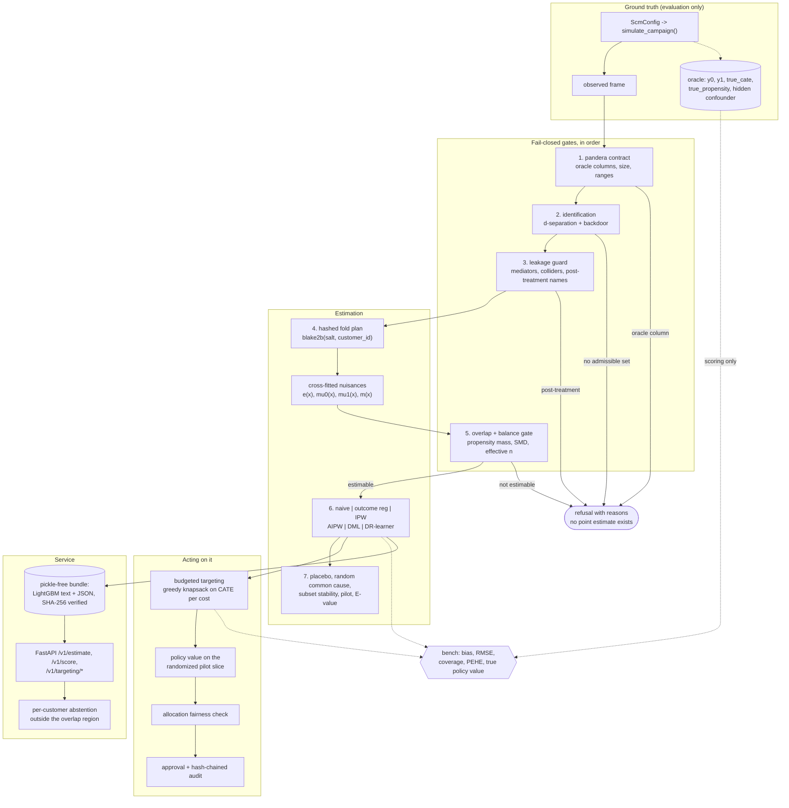

# double-ml-uplift

Estimates who changes behaviour *because of* a retention offer, using cross-fitted double machine
learning, and refuses to report a number when identification or overlap fails. Every estimator is
validated against a structural causal model that knows the truth.

## Problem

A churn-propensity model ranks customers by how likely they are to leave. Targeting that ranking
spends the budget on two groups it should not: customers who would have stayed anyway, and
customers the offer actively annoys. The question a retention campaign actually has is causal —
*whose behaviour does the offer change?* — and it is being answered with a correlational model.

Reaching for historical campaign data does not fix it. Those campaigns were targeted by a rule,
so treated and untreated customers differ systematically. A difference in means over that data is
not an effect, it is the old targeting rule reflected back. In the Monte Carlo below, the naive
difference reports **−19.1** against a true average effect of **+3.4**: not merely imprecise, but
confidently the wrong sign.

Adjusting for confounders needs assumptions, and this repository's position is that the
assumptions should be written down, checked where they are checkable, and allowed to fail loudly:

- the causal graph is a **YAML file**, version-controlled and hashed into every estimate;
- **identification** runs before estimation and refuses when no observed adjustment set blocks
  the backdoor paths;
- **overlap and balance diagnostics** gate the estimate, and a failure raises instead of
  returning a number;
- **refuters** (placebo, random common cause, subset stability, randomized-pilot consistency) and
  an **E-value** are stored with every estimate;
- **targeting value** is estimated on a randomized pilot slice, not on the observational data the
  model was trained on;
- exporting a list of real customers needs a **second operator's approval** and is hash-chain
  audited.

Nothing here discovers the graph. It checks that the graph you declared is consistent, that it
identifies the effect from the columns you have, and that the data can support the estimate. That
distinction is the whole product; see [MODEL_CARD.md](MODEL_CARD.md) for what it buys and what it
costs.

## Architecture



The order of the gates is the design. Every check that could refuse runs *before* a point
estimate exists, so there is never a number lying around that someone could quote after the
refusal. `EstimationConfig.enforce_gate=False` exists only so the Monte Carlo bench can measure
what the gate protects against; the service never exposes it.

Layout:

```text
src/double_ml_uplift/
  causal/   scm, spec, graph, identification, folds, nuisance, estimators,
            diagnostics, refutation, calibration, targeting, engine, bundle,
            publish (run manifest + registry), demo
  service/  app, auth (JWT roles), approvals, audit, identifiers, metrics, models
  ml/       pandera contracts, run manifest, registry, PSI/KS drift, safe serialization
  core/     settings, redacting logs, tracing, metrics, hardened FastAPI app
  configs/  scenarios/*.yaml (SCM draws)   specs/*.yaml (declared DAGs)
bench/bench_montecarlo.py   bench/bench_baseline.py   scripts/check_baseline.py
docs/CAUSAL_SPEC.md   docs/THREAT_MODEL.md   docs/adr/   CLAIMS.md   MODEL_CARD.md
```

## Quickstart

```bash
# Python 3.12 and uv. Keep the environment off a small disk if you need to:
export UV_PROJECT_ENVIRONMENT=~/.venvs/double-ml-uplift
uv sync

uv run python tasks.py demo        # the whole story, offline, ~10 s
uv run python tasks.py test        # 600+ tests with coverage
uv run python tasks.py lint typecheck audit baseline
uv run python tasks.py bench       # micro-benchmarks + 50-replication Monte Carlo
```

`make demo`, `make test`, ... do the same on Linux; the Makefile delegates to `tasks.py`.

The demo needs no API key and no network. It prints one JSON document showing an invalid
specification refused at load, a frame carrying potential outcomes refused by the contract, a
mediator refused by the leakage guard, an unmeasured common cause refused by identification, the
naive estimate missing the truth while AIPW and DML recover it, a positivity-violating campaign
refused by the overlap gate, an unmeasured confounder caught by the randomized pilot, a targeting
list held for a second operator's approval, and a tampered model artifact refused on load.

Inspect a bundled specification and what it identifies:

```bash
uv run python -m double_ml_uplift spec retention_offer   # exit 0, prints the adjustment set
uv run python -m double_ml_uplift spec unobserved        # exit 1, names the open backdoor path
```

Run the service (requires `APP_JWT_SECRET` and `APP_CUSTOMER_ID_PEPPER`; see `.env.example`):

```bash
uv run python -m double_ml_uplift serve
uv run python -m double_ml_uplift issue-token analyst-1 --role analyst   # local development only
```

## Results

Measured on this machine, not estimated: Windows 10, 6 CPUs (Intel i7-8700), Python 3.12.14,
CPU only, no GPU. Reproduce with the commands shown above each table.

### Estimator accuracy against ground truth

```bash
uv run python bench/bench_montecarlo.py --replications 50 --check
```

50 replications per scenario, n = 2,000, 184.3 s total. The gate is measured but not enforced
here, on purpose: the point is to show what it protects against.

| scenario | estimator | bias | RMSE | empirical SD | mean SE | coverage |
|---|---|---:|---:|---:|---:|---:|
| linear | naive | -13.675 | 15.079 | 6.418 | 6.873 | 0.520 |
| linear | outcome_regression | -3.247 | 4.172 | 2.645 | 1.103 | 0.320 |
| linear | ipw | +0.160 | 4.196 | 4.236 | 8.783 | 1.000 |
| linear | aipw | +1.910 | 3.535 | 3.005 | 3.942 | 0.980 |
| linear | dml | -0.386 | 2.562 | 2.559 | 2.569 | 0.960 |
| nonlinear | naive | -10.442 | 12.797 | 7.473 | 8.376 | 0.800 |
| nonlinear | outcome_regression | -7.320 | 7.778 | 2.655 | 1.216 | 0.020 |
| nonlinear | ipw | -0.497 | 6.213 | 6.256 | 11.151 | 1.000 |
| nonlinear | aipw | +2.061 | 4.614 | 4.170 | 4.997 | 0.980 |
| nonlinear | dml | -1.423 | 2.797 | 2.432 | 2.812 | 0.940 |
| heterogeneous | naive | -19.060 | 20.184 | 6.711 | 7.231 | 0.200 |
| heterogeneous | outcome_regression | -3.275 | 4.213 | 2.678 | 1.395 | 0.460 |
| heterogeneous | ipw | +0.574 | 4.416 | 4.423 | 9.200 | 1.000 |
| heterogeneous | aipw | +1.852 | 3.677 | 3.209 | 4.076 | 0.960 |
| heterogeneous | dml | -0.194 | 2.750 | 2.771 | 2.797 | 0.960 |
| weak_overlap | naive | -24.769 | 25.440 | 5.866 | 6.948 | 0.020 |
| weak_overlap | outcome_regression | -11.717 | 12.172 | 3.328 | 1.302 | 0.000 |
| weak_overlap | ipw | +5.455 | 11.959 | 10.751 | 17.163 | 1.000 |
| weak_overlap | aipw | +6.476 | 9.694 | 7.287 | 11.129 | 1.000 |
| weak_overlap | dml | -1.592 | 3.773 | 3.455 | 3.305 | 0.940 |

Reading it: AIPW and DML land in the 0.91–0.98 coverage band CI enforces, including when the
nuisances are misspecified (`nonlinear`). The naive difference is badly biased and its intervals
cover the truth 20–52% of the time. Outcome regression is the interesting failure: it is *nearly
unbiased* and still covers 2–46% of the time, because its reported standard error (1.1–1.4)
ignores nuisance estimation error and is three times too small. A plug-in "predict both arms and
subtract" pipeline looks excellent right up to the point where someone believes its interval.

IPW's 1.000 coverage is the opposite failure: its mean standard error is roughly twice its
empirical spread, so the interval is wide enough to be nearly useless.

`weak_overlap` is the row the gate exists for. DML's residual-on-residual form happens to survive
it, but AIPW's bias triples and IPW's RMSE goes to 12. In production none of these numbers is
reported at all:

| scenario | gate refusal rate |
|---|---:|
| linear | 0.000 |
| nonlinear | 0.000 |
| heterogeneous | 0.000 |
| weak_overlap | 1.000 |

### Conditional effects, refuters, and targeting

| scenario | PEHE DR-learner | PEHE outcome regression | PEHE constant ATE | calibration slope |
|---|---:|---:|---:|---:|
| heterogeneous | 11.62 | 31.00 | 43.73 | 1.088 |
| nonlinear | 11.75 | 36.76 | 22.84 | 0.890 |

| refuter | false-flag rate on a well-specified scenario |
|---|---:|
| placebo_treatment | 0.000 |
| random_common_cause | 0.000 |
| subset_stability | 0.000 |
| pilot_consistency | 0.000 |
| e_value (advisory) | 0.100 |

Unmeasured-confounder detection rate: **0.920** (mean bias +64.0 when it is present). The
randomized-pilot check is the only refuter here that can see unobserved confounding at all,
because it is the only one that does not assume unconfoundedness.

| targeting at a 20% budget | value |
|---|---:|
| pilot CI covers the true policy value | 1.000 |
| uplift ranking beats propensity ranking | 1.000 |
| mean true value, uplift ranking | 10.329 |
| mean true value, propensity ranking | -6.405 |
| mean true value, treat everyone | 3.436 |

Propensity ranking — target whoever the old rule would have targeted — has *negative* true value:
it systematically finds the customers the offer harms. Treating everyone is positive but small.
Uplift ranking at a fifth of the budget is worth three times treating everyone.

### The exact differential

`tests/unit/test_estimators.py::test_dml_without_crossfitting_equals_the_ols_coefficient` asserts
that partialling-out DML with OLS nuisances and cross-fitting disabled equals the statsmodels OLS
coefficient on the treatment to 1e-8 (Frisch–Waugh–Lovell). If the residualisation is ever
rewritten, that test says so immediately.

### Throughput

```bash
uv run python bench/bench_baseline.py --check --rows 200000
```

| benchmark | runs | p50 (us) | p95 (us) |
|---|---:|---:|---:|
| d_separation_24_node_dag | 2000 | 44.0 | 44.6 |
| identify_backdoor_retention_spec | 200 | 239.4 | 242.4 |
| fold_assignment_100k_ids | 10 | 112196.8 | 119260.3 |
| cross_fit_10k_rows_5_folds_gbm | 5 | 768345.2 | 777524.1 |
| score_10k_rows | 20 | 12017.0 | 13912.5 |
| drift_check_10k_vs_10k | 30 | 2185.3 | 2336.8 |
| audit_append_fsync | 100 | 6820.7 | 7908.9 |
| audit_verify_500_entries | 10 | 8747.5 | 9940.8 |

One full five-fold DML pass end to end, at 200,000 rows and six adjustment columns:

| scaling (200,000 rows, 5-fold DML) | prepare (s) | fit (s) | ATE | SE |
|---|---:|---:|---:|---:|
| ridge nuisances | 0.214 | 1.616 | 22.5772 | 0.2300 |
| gbm nuisances | 0.213 | 16.374 | 22.2267 | 0.2382 |

True ATE for that sample: **22.3984**. Both configurations recover it; the LightGBM nuisances
cost about eight times the wall clock of ridge for this (linear) scenario and earn it back on the
`nonlinear` one. `bench/thresholds.json` sets each p95 limit at roughly five times the measured
value, so CI catches an order-of-magnitude regression without failing on runner noise. The
scaling section is reported, not thresholded: the machine matters far more than the code.

## Security

Threats and controls are enumerated in [docs/THREAT_MODEL.md](docs/THREAT_MODEL.md); every row
names the test that holds it. The ones specific to this system:

- **Fail-closed estimation.** Identification, contract, overlap and balance failures return a
  refusal with reasons and no point estimate. The gate runs before the estimators.
- **Post-treatment leakage is a hard failure.** Mediators, colliders, descendants of the outcome,
  variables listed in `forbidden_columns` and pre-treatment variables whose *name* looks
  post-treatment (`*_after_*`, `post_*`, `*_at`) are all refused, and identification never
  proposes one.
- **The oracle never reaches an estimator.** `y0`, `y1`, `true_cate`, `true_propensity` and
  `hidden_confounder` are refused by the data contract with their own exception type.
- **Specifications are data.** `yaml.safe_load`, a 64 KiB cap, node and edge limits, acyclicity,
  a required directed path from treatment to outcome, and declared roles that must agree with
  the DAG.
- **Roles.** JWT bearer tokens, HS256 only, with required issuer, audience, expiry and a maximum
  lifetime. Analysts read aggregates; only operators may request, approve or release an export.
- **Exports need a second person.** An approval is bound to the SHA-256 of the exact payload
  (spec, config and dataset hashes, budget, ranking, cost, ordered pseudonyms), cannot be granted
  by the requester, can only be spent by the requester, is spent once, and expires.
- **Customers are pseudonyms.** Every response, log line, audit record and export refers to
  customers as `cid_<40 hex>` = HMAC-SHA256(pepper, id). Without a configured pepper the service
  refuses to start. Aggregates below `min_cohort_size` are refused.
- **Allocation fairness.** Every ranking is checked separately, and the list actually being
  released is the list that is judged: a targeting list whose selection rates differ between the
  protected groups by more than `APP_FAIRNESS_MAX_DISPARITY` is blocked before release, and the
  block is audited with the ranking that caused it.
- **Tamper-evident audit.** Every export request, decision, refusal and release is one JSON line
  whose digest covers the previous digest; records are redacted before they are hashed.
- **No pickle anywhere.** Models are LightGBM text dumps or JSON coefficients, each carrying its
  SHA-256, verified on load. Enforced by a test, a semgrep rule and `scripts/check_baseline.py`.
- **Caps.** Upload rows and columns, folds per request, bootstrap iterations per request,
  customers per scoring batch, request body size and a token-bucket rate limit.

## Non-goals

- **Causal discovery.** The DAG is an input. This repository checks it for structural sense and
  decides whether it identifies the effect; it never learns it from data. If the graph is wrong,
  every number here is wrong, and only the randomized-pilot check would notice.
- **Proving unconfoundedness.** No test can. The refuters can only fail to contradict the
  estimate. The pilot check detects strong unmeasured confounding 92% of the time in the bench —
  not weak confounding, and not at all without a randomized slice.
- **Continuous, multi-valued or dynamic treatments.** Binary treatment, single time point,
  single outcome. Instrumental variables, regression discontinuity, difference-in-differences and
  mediation analysis are all out of scope.
- **Real customer data.** Every dataset is simulated from the bundled SCM configs, which is what
  makes ground-truth validation possible. There is no connector, no warehouse integration and no
  PII handling beyond pseudonymisation of the simulated ids.
- **A model catalogue.** The service holds one specification, one configuration and the last
  successful estimation. Every successful estimation *is* published to a local content-addressed
  registry with its run manifest, and the response returns the version digest, but there is no
  multi-tenancy, no experiment UI and no background retraining: comparing twenty runs means
  reading twenty manifests. MLflow is **not** wired in — see "Deviations" below.
- **Clustered, panel or weighted sampling.** Rows are assumed independent. Influence-function
  standard errors and the multiplier bootstrap both assume it.
- **Production authentication.** Tokens are verified, never minted, in production paths.
  `issue-token` is for local development.

### Deviations from the original scope

Recorded honestly rather than quietly dropped:

- **MLflow is not used.** Bundles are written as a manifest plus hash-verified artifacts
  (`ScoringBundle.write`/`read`) and published to the in-repo content-addressed registry with a
  run manifest recording the interpreter, platform, package versions, git commit and lockfile
  digest — the reproducibility record the scope asked MLflow for. Adding an MLflow file backend
  would have added a large dependency whose default serialisation path is pickle, which this
  repository bans. See [ADR 0004](docs/adr/0004-bundles-instead-of-mlflow.md).
- **Polars is not used.** The frames are small enough that pandas plus the pandera contract
  already covers the work, and one dataframe library is simpler to reason about than two.
- **networkx is not used.** The DAG, d-separation and the backdoor criterion are implemented in
  `causal/graph.py` instead — roughly 250 lines — precisely so the repository's own tests can
  check them against brute-force enumeration of every simple trail. Depending on a library for
  the one piece of logic the project is meant to demonstrate would have made that test vacuous.
  The dependency was dropped rather than left declared and unused.
- **statsmodels is a development dependency, not a runtime one.** It is used by exactly one test,
  the Frisch-Waugh-Lovell differential, where it is the independent implementation that DML is
  pinned against. Shipping it in the service image would add weight nothing at runtime calls.
- **The Monte Carlo report runs 50 replications, not 200.** 50 is what fits in CI minutes on a
  6-CPU CPU-only machine; `--replications 200` is supported and the tolerance bands narrow
  automatically with the replication count.
- **The scaling measurement runs at 200,000 rows, not 1,000,000.** The development machine has
  about 2 GB of free RAM; 1M rows with five-fold cross-fitting over four nuisance models did not
  fit. The command takes `--rows`, so the larger number is one flag away on a bigger machine.

## Licence

MIT. See [LICENSE](LICENSE).
