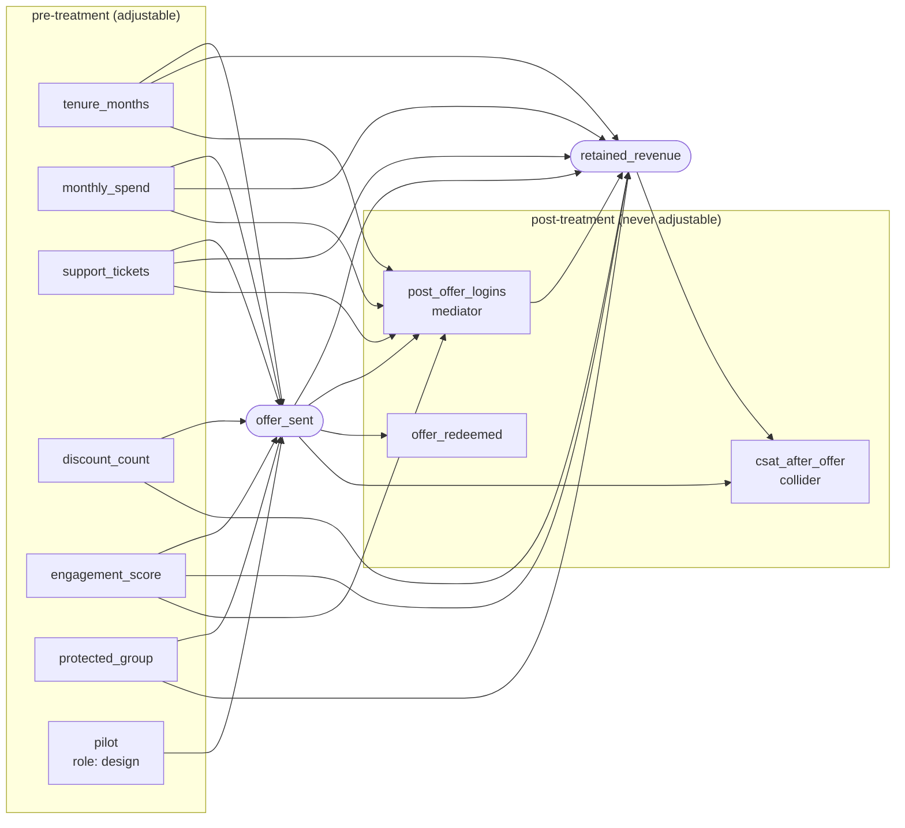

# The causal specification

A causal specification is a YAML file declaring what the analyst believes about how the world
works: which variable is the treatment, which is the outcome, which arrows connect the rest, and
which columns must never be adjusted for. It is **data, not code** — parsed with `yaml.safe_load`
from a size-limited document, validated by pydantic, and then checked for structural sense.

Its SHA-256 is recorded with every estimate and every stored bundle, so a bundle cannot be reused
under a different specification without that being visible.

Bundled examples live in `src/double_ml_uplift/configs/specs/`:
`retention_offer.yaml` (valid), `unobserved.yaml` (valid but not identified),
`leaky.yaml` (deliberately invalid — it fails to load, and the demo shows it failing).

## Format

```yaml
version: 1                       # literal 1
name: retention-offer            # ^[a-z0-9][a-z0-9_-]{0,63}$
unit_id: customer_id             # the row identifier. NOT a node of the DAG
treatment: offer_sent            # must be a declared node, binary, role: treatment
outcome: retained_revenue        # must be a declared node, role: outcome
pilot_column: pilot              # optional; a binary node marking the randomized slice
protected_attribute: protected_group   # optional; a binary node, for the fairness check

nodes:                           # 2..200 entries, names ^[a-z][a-z0-9_]{0,62}$
  tenure_months:
    kind: continuous             # continuous | count | binary
    role: confounder             # confounder | treatment | outcome | design | post_treatment
    observed: true               # default true; false means "declared but not in the data"
    minimum: 0                   # optional range, enforced by the pandera contract
    maximum: 240
    description: Months since signup, measured before the campaign window.

edges:                           # 0..2000 [source, target] pairs, all directed
  - [tenure_months, offer_sent]
  - [tenure_months, retained_revenue]
  - [offer_sent, retained_revenue]

forbidden_columns:               # optional; never admissible whatever the graph says
  - post_offer_logins
```

### `kind`

Determines the dtype and checks in the derived pandera schema:

| kind | dtype | checks |
|---|---|---|
| `continuous` | `float64` | `>= minimum`, `<= maximum` if given; not null |
| `count` | `int64` | `>= minimum`, `<= maximum` if given; not null |
| `binary` | `int64` | `isin([0, 1])`; not null; takes no explicit bounds |

### `role`

The role is not decoration. It is cross-checked against the graph, so a mediator cannot be hidden
behind a `confounder` label:

| role | meaning | validated as |
|---|---|---|
| `treatment` | the intervention | exactly the node named in `treatment`; must be `binary` and observed |
| `outcome` | what the effect is on | exactly the node named in `outcome`; must be observed |
| `post_treatment` | recorded after the intervention: mediators, colliders, redemption flags | **must** be a descendant of the treatment or the outcome |
| `confounder` | a pre-treatment variable | must **not** be a descendant of either |
| `design` | a pre-treatment variable that is part of the experiment design rather than the causal story, such as the pilot flag | same as `confounder` |

Both directions are enforced. A node downstream of the treatment that is declared `confounder` is
rejected ("adjusting for it would leak post-treatment information"); a node upstream that is
declared `post_treatment` is rejected too ("add the missing edge or correct the role"), because
that usually means the analyst knows something the graph does not say.

### `observed`

`observed: false` declares a variable that exists in the world but not in the data — a latent
common cause. It is not expected in the frame, it can never enter an adjustment set, and it is
exactly how a specification says "I know this confounder exists and I cannot measure it".
`unobserved.yaml` uses it for `churn_risk`, and identification consequently refuses.

Declaring a latent confounder is the honest move. Omitting it makes the specification *pass*.

### `forbidden_columns`

Belt and braces. Anything listed here is refused as an adjustment variable regardless of its
position in the graph. The bundled specification lists all three post-treatment columns even
though the DAG already places them downstream, so a reviewer can see the intent without tracing
edges.

## What is validated, and in what order

1. **Size** — the document must be at most 64 KiB, checked before parsing.
2. **Parse** — `yaml.safe_load`, which cannot construct arbitrary Python objects. A
   `!!python/object/apply:os.system` tag is refused, not executed.
3. **Shape** — pydantic: field patterns, `extra="forbid"` (a typo is an error, not an ignored
   key), 2–200 nodes, at most 2,000 edges, and `[source, target]` pairs of strings.
4. **Structure** —
   - `unit_id` must not be a node (it identifies rows; it is not part of the causal story);
   - treatment and outcome must be declared nodes, must differ, and must both be observed;
   - the treatment must be `binary`;
   - `pilot_column` and `protected_attribute`, if given, must be declared binary nodes;
   - `forbidden_columns` must name declared nodes;
   - the edges must form a DAG — no self-loops, no cycles;
   - there must be a **directed path from the treatment to the outcome**. A specification in which
     the treatment cannot affect the outcome is not a question this tool answers.
5. **Roles** — the cross-checks described above.

Everything downstream is derived from the validated specification rather than configured
separately: the pandera contract (`frame_columns()` is the unit id plus every observed node), the
identification query, the leakage guard and the reproducibility manifest.

## What is *not* validated

**Whether the graph is true.** Nothing here discovers structure, tests conditional independencies
against the data, or warns that an edge looks implausible. A specification that simply omits the
arrow from an unrecorded common cause into both the treatment and the outcome is structurally
perfect, identifies the effect, passes every gate, and produces a confidently wrong number. The
randomized-pilot refuter is the only thing in the system that would notice, and only if the
confounding is strong and a pilot slice exists.

This is the central trade-off of the whole repository. See [MODEL_CARD.md](../MODEL_CARD.md) and
[ADR 0005](adr/0005-hashed-folds-and-a-randomized-pilot.md).

## Worked example: the bundled retention offer

The DAG in `retention_offer.yaml`:



Identification returns six variables:

```bash
$ uv run python -m double_ml_uplift spec retention_offer
{
  "spec": "retention_offer",
  "valid": true,
  "identified": true,
  "adjustment_set": ["discount_count", "engagement_score", "monthly_spend",
                     "protected_group", "support_tickets", "tenure_months"],
  ...
}
```

Three things are worth noticing in that answer.

**`pilot` is not in the set.** It is a parent of the treatment only — it has no arrow into the
outcome — so it lies on no backdoor path and blocks nothing. Including it would be harmless but
useless; the greedy minimisation drops it. A variable that predicts only the treatment adds
variance to a propensity model without removing bias.

**The three post-treatment columns are not in the set**, and not merely because they are listed in
`forbidden_columns`. `post_offer_logins` is a mediator: adjusting for it would remove the part of
the effect that runs through it. `csat_after_offer` is a collider on the treatment and the
outcome: adjusting for it would *create* an association where none existed. Identification never
proposes them, and the leakage guard would refuse them if it did.

**`protected_group` is in the set.** It is a genuine common cause in this graph, so it is needed
for the estimate to be unbiased. Using it to *estimate* and then checking that the resulting
allocation is not disparate are different operations; the fairness check operates on the selected
list, not on the model's inputs.

Now the variant with a latent confounder:

```bash
$ uv run python -m double_ml_uplift spec unobserved
{
  "identified": false,
  "reasons": [
    "no observed adjustment set satisfies the backdoor criterion for offer_sent -> retained_revenue",
    "open backdoor path: offer_sent <- churn_risk -> retained_revenue"
  ],
  ...
}
```
Exit code 1, and no estimate is possible with this specification at all.

## Writing your own

1. Start from `retention_offer.yaml`.
2. List every variable you have, plus the ones you know exist but cannot measure
   (`observed: false`). The second list is the one that decides whether the answer means anything.
3. Draw the arrows you believe in. An arrow means "this causes that", not "these are correlated".
4. Set `role` honestly. If something was recorded after the offer went out, it is
   `post_treatment`, even if it would improve the fit.
5. Run `uv run python -m double_ml_uplift spec <name>`. If it refuses, the refusal names an open
   backdoor path — that is the confounder you need to measure, or the experiment you need to run.
6. Add anything you would be embarrassed to adjust for to `forbidden_columns`.

Loading a file from outside the package uses `load_spec_file(Path(...))`, which applies the same
size limit and the same validation.
