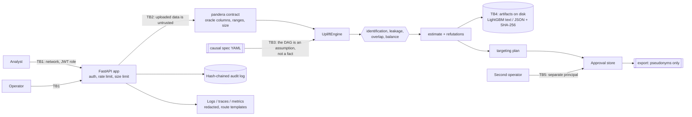

# Threat model

Method: STRIDE per trust boundary. Each row maps a threat to the control that addresses it and to
the test, bench script or CI job that proves the control works. `scripts/check_baseline.py`
verifies that every backticked evidence reference exists.

This system's distinguishing asset is not a secret. It is **the validity of a number that people
act on**. A retention campaign targets customers because this service said the offer changes
their behaviour; an estimate that is quietly wrong spends a budget on the wrong people and, in the
heterogeneous case, on people the offer actively harms. So the threats below include several that
a conventional web-service threat model would not: a causal graph that hides a mediator, an
adjustment set chosen to produce a desired answer, a data frame carrying the ground truth it is
supposed to be estimating.

## System and trust boundaries

Assets: the validity of reported effects, the list of customers a campaign will contact, personal
data in uploads and logs, API keys and the JWT signing key, the HMAC pepper, audit evidence, and
model artifacts.

Assumptions: TLS terminates in front of the service; the host and container runtime are trusted;
the identity provider that mints JWTs is trusted and binds `sub` to a real person; the analyst who
writes the causal specification is not hostile but may be wrong.

## STRIDE table

| ID | STRIDE | Threat | Entry point / asset | Control | Test / evidence | Residual risk |
|---|---|---|---|---|---|---|
| S1 | Spoofing | Caller presents a forged, foreign, expired or unbounded-lifetime token, or none at all | TB1, every `/v1` route | HS256 only, so an `alg: none` or RSA header cannot bypass verification; issuer, audience, `exp`, `iat`, `sub` and `role` all required; lifetime capped at `APP_JWT_MAX_LIFETIME_SECONDS`; no signing key means every role route fails closed | `tests/integration/test_service.py::test_a_token_signed_with_another_key_is_refused`, `tests/integration/test_service.py::test_a_token_that_outlives_the_configured_maximum_is_refused`, `tests/integration/test_service.py::test_malformed_tokens_are_refused`, `tests/integration/test_service.py::test_without_a_signing_key_every_role_route_fails_closed` | Tokens are bearer credentials: a stolen one works until it expires. No revocation list. |
| S2 | Spoofing | An operator approves its own export, or a different operator spends someone else's approval | TB5, approval store | Separation of duties: the requester cannot decide its own request, and only the requester may consume the approval | `tests/integration/test_service.py::test_the_full_approval_flow_releases_only_pseudonyms` | Two colluding operators defeat it; the audit chain is what makes that visible afterwards. |
| S3 | Spoofing | A caller presents an API key to read `/metrics` that it guessed or brute-forced | TB1, `/metrics` | Keys stored as SHA-256 digests, constant-time compare against every digest with no early exit, fail closed with no keys configured | `tests/unit/test_security.py::test_every_configured_digest_is_compared_without_early_exit`, `tests/unit/test_security.py::test_no_configured_keys_fails_closed`, `tests/integration/test_service.py::test_metrics_require_an_api_key_not_a_role_token` | No key expiry or rotation workflow. |
| T1 | Tampering | Audit entries edited, deleted, reordered or truncated | Audit log file | SHA-256 chain over canonical JSON; each entry's digest covers the previous one; a broken chain refuses to open; an anchored head detects tail truncation; writers take a file lock and re-read the tail | `tests/integration/test_service.py::test_the_audit_chain_covers_the_whole_export_and_verifies`, `tests/integration/test_demos_cli.py::test_cli_audit_verify` | Whoever can write the file can rebuild the whole chain. Publish the head digest elsewhere. |
| T2 | Tampering | A stored model artifact is swapped, corrupted or replaced with an executable payload | TB4, bundle on disk | Every artifact carries its SHA-256 in the manifest and is verified on load; only LightGBM text dumps and JSON coefficient documents are accepted; no `pickle`, `joblib` or `cloudpickle` anywhere in the path | `tests/unit/test_bundle.py::test_a_tampered_payload_is_refused_rather_than_scored_with`, `tests/unit/test_bundle.py::test_a_bundle_on_disk_with_a_tampered_artifact_is_refused`, `tests/unit/test_bundle.py::test_the_payload_is_json_or_text_and_never_a_pickle`, `tests/unit/test_no_pickle.py::test_source_tree_has_no_pickle_family_serialization`, `.github/workflows/ci.yml#semgrep` | The manifest itself is not signed: whoever can rewrite both the blob and its recorded hash succeeds. |
| T3 | Tampering | The targeting plan is changed between approval and release, so a different set of customers is contacted | TB5, export payload | The approval commits to the SHA-256 of the exact payload — spec, config and dataset hashes, budget fraction, ranking, cost and the ordered pseudonyms — and the digest is recomputed and compared at release | `tests/integration/test_service.py::test_an_approval_does_not_carry_over_to_a_different_plan`, `tests/integration/test_service.py::test_the_full_approval_flow_releases_only_pseudonyms` | The approval file is not signed; protect it like the audit log. |
| T4 | Tampering | An approval is replayed to release the same list twice, or an unapproved/denied request is released | TB5 | An approval is consumed once, under a file lock, and only in the `approved` state; it expires | `tests/integration/test_service.py::test_a_denied_export_cannot_be_released`, `tests/integration/test_service.py::test_an_unapproved_export_cannot_be_released` | None known within the process model. |
| T5 | Tampering | A causal specification is edited to hide a mediator as a confounder, or to declare a post-treatment column pre-treatment, so leakage inflates the effect | TB3, spec YAML | Declared roles must agree with the DAG: any node downstream of the treatment or the outcome must be declared `post_treatment`, and any node declared `post_treatment` must actually be downstream. The leakage guard independently re-checks the adjustment set even if the validator were bypassed. The spec's SHA-256 is recorded with every estimate. | `tests/unit/test_spec.py::test_a_node_downstream_of_the_treatment_must_be_declared_post_treatment`, `tests/unit/test_identification.py::test_the_guard_still_refuses_when_the_declared_roles_are_wrong`, `tests/unit/test_identification.py::test_a_mediator_not_listed_as_forbidden_is_still_refused_by_its_role` | A spec that simply **omits** an edge is consistent and cannot be detected from the graph. Only the randomized-pilot refuter would notice the consequence. |
| T6 | Tampering | A malicious specification file executes code when it is parsed, or exhausts memory | TB3, spec YAML | `yaml.safe_load` cannot construct arbitrary Python objects; a 64 KiB cap is checked before parsing; 200 nodes and 2,000 edges maximum; unknown keys refused | `tests/unit/test_spec.py::test_yaml_tags_that_would_construct_python_objects_are_refused`, `tests/unit/test_spec.py::test_a_specification_larger_than_the_limit_is_refused_before_parsing`, `tests/unit/test_spec.py::test_extra_keys_are_refused_so_a_typo_cannot_be_ignored` | None known. |
| T7 | Tampering | A customer id is chosen so the customer lands in a particular cross-fitting fold, steering the estimate | Fold assignment | Folds are `blake2b(unit_id, key=salt) mod k`; the salt is configuration, not data, so an attacker who can choose ids cannot aim them without it. `APP_FOLD_SALT` sets a per-environment secret salt; only its hash leaves the process, inside `config_sha256`. Contract also constrains the id format. | `tests/unit/test_folds.py::test_a_different_salt_reassigns_a_meaningful_share_of_units`, `tests/unit/test_folds.py::test_a_units_fold_never_depends_on_the_other_units`, `tests/integration/test_service.py::test_a_deployment_salt_changes_the_folds_and_only_its_hash_leaves_the_process`, `tests/unit/test_ml_contracts.py::test_a_customer_id_with_odd_characters_is_refused` | **The bundled default salt is the public literal `retention-offer`**, committed here and hashed into every response, so at the default setting the keying provides reproducibility and no unpredictability. Set `APP_FOLD_SALT` where fold assignment is adversarially relevant. |
| R1 | Repudiation | Dispute over who released a list of customers to contact, and which list | Approval store, audit log | Every request, decision, fairness block and release is an audit entry naming the actor, the request id, the payload digest and the size of the list | `tests/integration/test_service.py::test_the_audit_chain_covers_the_whole_export_and_verifies`, `tests/integration/test_service.py::test_a_disparate_allocation_is_blocked_and_audited` | Timestamps are the service's own clock, not independently attested. |
| R2 | Repudiation | Dispute over which data and assumptions produced a reported number | Estimate | Every estimate records the spec SHA-256, the configuration SHA-256, the dataset digest and the fold digest; identical inputs reproduce identical numbers | `tests/integration/test_engine.py::test_the_result_records_every_hash_needed_to_reproduce_it`, `tests/integration/test_engine.py::test_the_same_inputs_produce_the_same_number_and_the_same_hashes` | The hashes identify the inputs; they do not store them. |
| I1 | Information disclosure | A response, log line, audit record or export reveals which real customers are in a cohort | TB1, responses and logs | Customer ids appear only as `cid_<40 hex>` = HMAC-SHA256(pepper, id); the pepper never leaves the process and the service refuses to start without one; aggregates below `min_cohort_size` are refused | `tests/integration/test_service.py::test_scored_customers_come_back_pseudonymised_with_group_intervals`, `tests/integration/test_service.py::test_the_pseudonym_is_stable_and_keyed`, `tests/integration/test_service.py::test_without_a_pepper_the_service_refuses_to_start`, `tests/integration/test_service.py::test_the_audit_log_never_records_a_raw_customer_id`, `tests/integration/test_service.py::test_a_cohort_below_the_minimum_is_refused` | Pseudonyms are stable by design, so the same customer is linkable across exports. A caller who already knows the id set can confirm membership. |
| I2 | Information disclosure | A data-contract error echoes a customer's spend, tenure or identifier back to the caller | TB2, error bodies | Failures are summarised as (column, check, count). Schema-level checks name the offending *column*, which is structure; every data-level check reports only a count | `tests/unit/test_ml_contracts.py::test_a_failure_summary_carries_counts_and_never_a_cell_value`, `tests/unit/test_ml_contracts.py::test_naming_a_column_never_extends_to_naming_a_value`, `tests/unit/test_ml_contracts.py::test_a_customer_id_never_appears_in_the_summary_of_another_columns_failure` | None known. |
| I3 | Information disclosure | PII or secrets written to logs, traces or audit records | Logs, audit log | structlog and stdlib redaction processor, applied after traceback formatting; audit data is redacted *before* it is hashed, so the chain commits to the redacted form | `tests/unit/test_logging.py::test_exception_tracebacks_are_redacted`, `tests/unit/test_redaction.py::test_known_secret_and_pii_formats_are_redacted`, `tests/unit/test_redaction.py::test_any_email_address_is_redacted`, `tests/unit/test_logging.py::test_sets_bytes_objects_and_mapping_keys_are_redacted_before_rendering` | Pattern-based: names, postal addresses and free-form identifiers are not detected. |
| I4 | Information disclosure | Error bodies leak exception text, file paths or submitted values | TB1, responses | Fixed error codes and messages; validation details without input; readiness reports names only | `tests/integration/test_app.py::test_unhandled_exceptions_become_generic_500s`, `tests/integration/test_app.py::test_validation_errors_never_echo_submitted_values`, `tests/integration/test_app.py::test_readyz_reports_check_names_without_error_details` | None known. |
| I5 | Information disclosure | A stored bundle carries the training data it was fitted on | TB4 | The bundle keeps only model parameters, the adjustment set names, the gate policy, the calibration bins and a capped, down-sampled vector of training propensities for drift comparison | `tests/unit/test_bundle.py::test_the_bundle_keeps_a_reference_sample_for_drift_but_not_the_training_data`, `tests/unit/test_bundle.py::test_the_reference_sample_is_capped_and_deterministic` | A fitted model always encodes something about its training data; this bounds it, it does not eliminate it. |
| I6 | Information disclosure | Metrics expose raw paths or ids, or are readable by anyone | `/metrics` | Route-template labels; refusal reasons drawn from a fixed set with unknown values folded into `other`; an API key required by default | `tests/integration/test_app.py::test_metrics_require_auth_and_label_route_templates`, `tests/integration/test_service.py::test_an_unknown_refusal_reason_is_folded_into_a_bounded_label` | Operators may disable auth for scraping; restrict by network then. |
| I7 | Information disclosure | Secrets committed to the repository | Git history | Only `.env.example` is committed, with empty values for every secret; `.env` ignored; gitleaks and semgrep in CI | `tests/unit/test_config.py::test_env_example_documents_every_setting`, `.github/workflows/ci.yml#gitleaks`, `.github/workflows/ci.yml#semgrep` | Scanners miss unusual secret formats. |
| I8 | Information disclosure | Cross-origin pages read API responses | Browsers | Explicit origin list, no credentials, `*` refused by config validation; strict security headers | `tests/integration/test_app.py::test_cors_allows_only_configured_origins`, `tests/unit/test_config.py::test_wildcard_or_malformed_origins_are_rejected` | None known. |
| D1 | Denial of service | Request floods | TB1 | Token bucket per verified key or per client address (IPv6 grouped by /64); invalid keys share the address bucket; probes exempt | `tests/integration/test_app.py::test_rate_limit_rejects_bursts_and_exempts_probes`, `tests/integration/test_app.py::test_invalid_keys_cannot_mint_fresh_rate_limit_buckets`, `tests/unit/test_ratelimit.py::test_admissions_never_exceed_the_token_bucket_bound` | In-process only; behind a proxy all clients share one address unless proxy headers are trusted. |
| D2 | Denial of service | A huge upload, or a small upload asking for enormous work: 20 folds and 5,000 bootstrap replications over a million rows | TB2, `/v1/estimate` | Row and column limits in the contract, checked before parsing work; `max_upload_rows`, `max_request_folds`, `max_request_bootstrap` and `max_score_rows` caps; body-size limit middleware | `tests/integration/test_service.py::test_per_request_caps_are_enforced`, `tests/integration/test_service.py::test_too_many_customers_in_one_batch_is_refused`, `tests/unit/test_ml_contracts.py::test_an_oversized_frame_is_refused_cheaply`, `tests/integration/test_app.py::test_body_size_limit_applies_to_declared_and_streamed_bodies` | An upload at the cap still costs real CPU; size the caps to the deployment. |
| D3 | Denial of service | A dense causal graph makes path enumeration exponential | TB3, spec | d-separation is linear-time reachability and is what every decision uses; `simple_paths` (used only for refusal messages and as a test oracle) takes an explicit exploration limit; node and edge counts are capped | `tests/unit/test_graph.py::test_simple_paths_stops_at_the_exploration_limit`, `bench/bench_baseline.py` | None known within the declared limits. |
| D4 | Denial of service | Crafted text makes redaction backtrack quadratically | Redaction | Patterns start only at the beginning of a run and use possessive or RFC-bounded quantifiers | `tests/unit/test_redaction.py::test_redaction_stays_fast_on_adversarial_input`, `bench/bench_baseline.py` | Other regex-heavy code needs the same review. |
| D5 | Denial of service | An operator token is used to flood the approval store, evicting another operator's pending or approved export so the release fails with "unknown export request" | `/v1/targeting/requests` | The cap prunes expired and already-decided records first; a request that would evict a live record is refused with `503 approval_store_full` instead | `tests/unit/test_approvals.py::test_a_flood_of_requests_cannot_evict_somebody_elses_pending_approval`, `tests/integration/test_service.py::test_a_full_approval_store_refuses_rather_than_evicting_a_live_request` | A store full of live requests refuses new ones until some are decided or expire; that is the trade chosen over silent eviction. |
| D6 | Denial of service | Container exhausts host resources | Runtime | Compose memory, CPU and PID limits | `.github/workflows/ci.yml#docker` | Limits are deployment-specific. |
| E1 | Elevation of privilege | An analyst releases a list of real customers to contact | TB1, roles | `/v1/targeting/*` requires the operator role; the analyst role is strictly below it | `tests/integration/test_service.py::test_an_analyst_may_not_request_an_export`, `tests/integration/test_service.py::test_every_route_requires_a_bearer_token` | A compromised operator token releases lists until it expires. |
| E2 | Elevation of privilege | Code execution inside the container escalates | Runtime | Non-root UID 10001; read-only root filesystem; all capabilities dropped; no-new-privileges | `.github/workflows/ci.yml#docker` | Kernel or runtime vulnerabilities. |
| E3 | Elevation of privilege | Compromised dependency, base image or CI action | Build pipeline | `uv.lock` with hashes; pip-audit; base images pinned by digest; trivy scan; CycloneDX SBOM; Dependabot | `.github/workflows/ci.yml#pip-audit`, `.github/workflows/ci.yml#docker` | Actions are tag-pinned until SHA pinning at publish time. |

## Validity threats

These are not STRIDE categories. They are the ways this system produces a *wrong number* rather
than leaking or losing one, and they are the reason most of the code exists.

| ID | Threat | Control | Test / evidence | Residual risk |
|---|---|---|---|---|
| V1 | The effect is not identified from the observed columns — a common cause was never recorded — and the pipeline reports an adjusted number anyway | Backdoor identification runs before estimation and refuses, naming an open path. Proven **complete**: when it refuses, no subset of the admissible variables would have worked | `tests/unit/test_identification.py::test_a_refusal_means_no_admissible_subset_would_have_worked`, `tests/unit/test_identification.py::test_an_unmeasured_common_cause_refuses_and_names_the_open_path`, `tests/integration/test_engine.py::test_an_unidentified_specification_refuses_before_touching_the_data` | Completeness is relative to the **declared** graph. An unrecorded confounder that is also undeclared is invisible here. |
| V2 | Identification falsely refuses a query that is answerable, so an honest analysis is blocked and someone routes around the tool | The search starts from the canonical adjustment set (allowed ancestors of treatment and outcome) rather than from every pre-treatment covariate, which is what makes it complete; the M-bias structure is the classic case where "adjust for everything" fails | `tests/unit/test_identification.py::test_a_refusal_means_no_admissible_subset_would_have_worked`, `tests/unit/test_identification.py::test_fixture_dags_get_the_adjustment_set_theory_predicts` | Variables excluded by policy (forbidden columns, post-treatment names) can still cause a refusal; that is deliberate and visible in `considered`. |
| V3 | Post-treatment leakage: a mediator, a collider, or a column recorded after the intervention enters the adjustment set and the estimate is confidently wrong | Four independent barriers: the spec validator refuses mislabelled roles; `forbidden_columns`; the leakage guard rejects descendants of treatment or outcome and names that look post-treatment; identification never proposes one | `tests/unit/test_identification.py::test_leakage_guard_names_the_offender_and_the_reason`, `tests/unit/test_identification.py::test_a_pre_treatment_variable_with_a_post_treatment_name_is_refused`, `tests/integration/test_service.py::test_asking_to_adjust_for_a_mediator_is_refused` | A leaked column that is not in the DAG at all is refused by the contract's `strict=True`, but a column declared pre-treatment that truly is not stays undetected. |
| V4 | Positivity fails — the old targeting rule was near-deterministic — so the estimate is extrapolation with a confident interval attached | The overlap and balance gate measures propensity mass outside `[0.05, 0.95]`, weighted SMD per covariate and Kish effective sample size, and raises before any estimator runs. The bench refuses 100% of positivity-violating draws and 0% of well-specified ones | `tests/integration/test_engine.py::test_a_positivity_violation_refuses_before_a_number_exists`, `tests/unit/test_diagnostics.py::test_a_positivity_violation_is_refused_with_a_reason`, `bench/bench_montecarlo.py` | The thresholds are a judgement call. A campaign just inside them is still partly extrapolating. |
| V5 | An interval is reported that is far too narrow, so a decision is made with false confidence | AIPW and DML report influence-function standard errors, and the Monte Carlo bench enforces 0.91–0.98 coverage in CI. Outcome regression is shipped precisely so its under-coverage (0.02–0.46) is visible next to them | `bench/bench_montecarlo.py`, `.github/workflows/ci.yml#montecarlo` | Coverage is measured on the bundled SCMs, not on the user's data. |
| V6 | An analyst tries adjustment sets until one produces the wanted answer | Every estimate records the spec hash, configuration hash, dataset digest and fold digest; a caller-supplied adjustment set is re-verified against the backdoor criterion and refused if it leaves a path open; all five estimators are always returned together | `tests/integration/test_service.py::test_an_adjustment_set_that_leaves_a_backdoor_open_is_refused`, `tests/integration/test_engine.py::test_the_result_records_every_hash_needed_to_reproduce_it` | The service does not count or rate-limit specification variants. The audit chain covers exports, not estimation attempts. |
| V7 | A ground-truth column — a potential outcome, the true effect, the true propensity or the hidden confounder — reaches an estimator, producing a perfect-looking model | The data contract refuses those column names first, with their own exception type, before size or schema checks | `tests/unit/test_ml_contracts.py::test_every_oracle_column_is_refused_by_name`, `tests/unit/test_ml_contracts.py::test_the_leak_check_runs_before_the_size_checks`, `tests/unit/test_scm.py::test_the_observed_frame_carries_no_oracle_column` | The block list is by name. A renamed oracle column would pass the name check and then be refused by `strict=True` for not being declared. |
| V8 | Unobserved confounding is present, every gate passes, and the number is badly wrong | The randomized-pilot consistency refuter compares the observational estimate against a difference in means on the randomized slice, which needs no unconfoundedness assumption. Detection rate 0.92 in the bench. E-values report how strong an unmeasured confounder would need to be | `tests/integration/test_engine.py::test_an_unmeasured_confounder_is_caught_by_the_pilot`, `tests/unit/test_refutation.py::test_the_pilot_check_catches_an_observational_estimate_that_is_far_off`, `bench/bench_montecarlo.py` | **Without a randomized slice there is no check at all.** Weak confounding is not detected. This is the single largest residual risk in the system. |
| V9 | A CATE model is scored on customers unlike anything it was fitted on | Per-customer abstention outside the overlap region, at scoring time and in targeting; a PSI gauge compares the scoring population's propensity distribution against the training population's | `tests/integration/test_engine.py::test_a_customer_far_outside_the_training_population_gets_an_abstention`, `tests/integration/test_engine.py::test_customers_outside_the_overlap_region_are_never_targeted`, `tests/integration/test_service.py::test_scored_customers_come_back_pseudonymised_with_group_intervals` | Abstention uses the propensity only; a customer inside the propensity range but outside the covariate support is not caught. |
| V10 | A targeting policy's value is estimated on the same observational data that trained the CATE model, so the estimate flatters itself | Policy value is estimated only on the randomized pilot slice, as a difference in means among targeted customers; a slice too thin to support the estimate yields no value rather than a guess | `tests/unit/test_targeting.py::test_the_pilot_estimate_brackets_the_truth_it_is_estimating`, `tests/unit/test_targeting.py::test_a_pilot_too_thin_to_value_the_policy_is_refused_rather_than_guessed`, `bench/bench_montecarlo.py` | The pilot interval is wide at realistic pilot sizes; it bounds the value, it does not pin it down. |
| V11 | A targeting list systematically excludes one protected group | Demographic-parity check on the selection rates before release, computed per ranking so the released list is the judged list, blocking above `APP_FAIRNESS_MAX_DISPARITY`, with the block and the offending ranking written to the audit chain | `tests/integration/test_service.py::test_a_disparate_allocation_is_blocked_and_audited`, `tests/integration/test_service.py::test_the_fairness_check_is_computed_on_the_ranking_being_released`, `tests/unit/test_targeting.py::test_a_one_sided_allocation_is_blocked` | Demographic parity is one fairness definition among several, on one synthetic binary attribute. It says nothing about intersectional disparity. A specification that declares no protected attribute gets no check at all: it reports `checked: false` rather than an invented `0.0`, and it does not block. The service's bundled specification declares one. |
| V12 | A refactor silently breaks the residualisation, and every number shifts without a test failing | The FWL differential pins partialling-out DML with OLS nuisances and no cross-fitting to the statsmodels OLS coefficient at 1e-8; cross-fitting is verified by refitting each fold by hand | `tests/unit/test_estimators.py::test_dml_without_crossfitting_equals_the_ols_coefficient`, `tests/unit/test_nuisance.py::test_every_prediction_comes_from_a_model_that_never_saw_its_own_row` | None known. |
